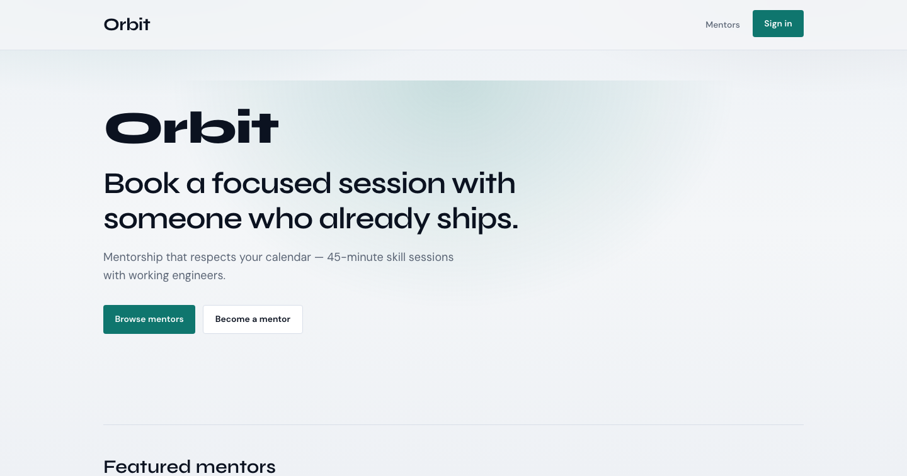
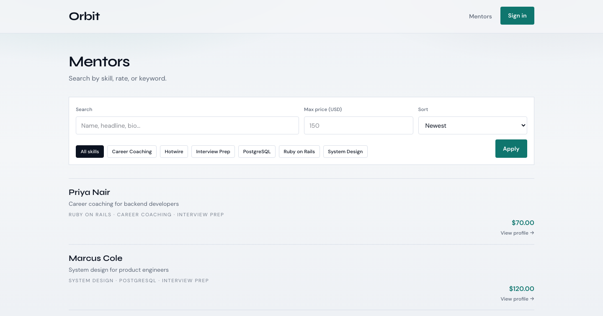
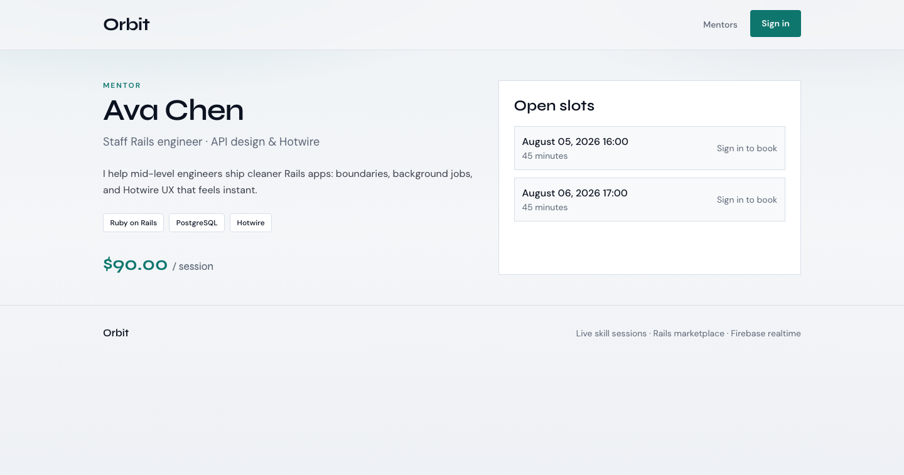
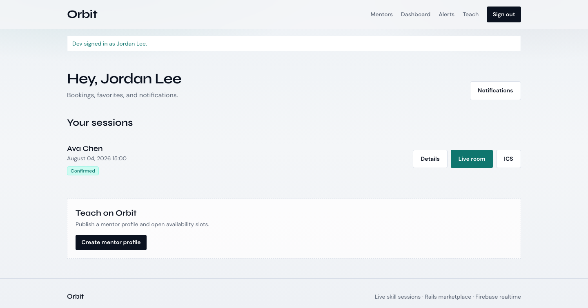
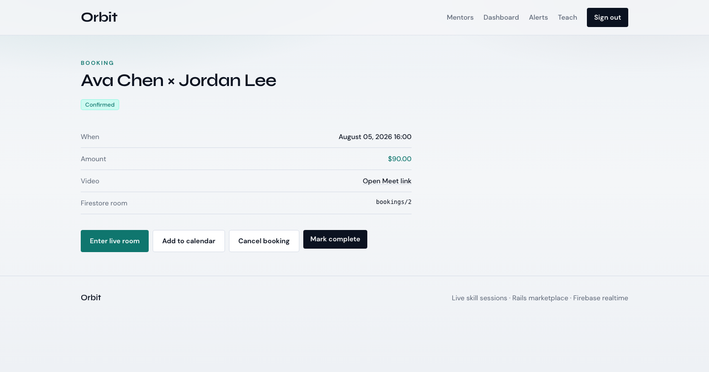
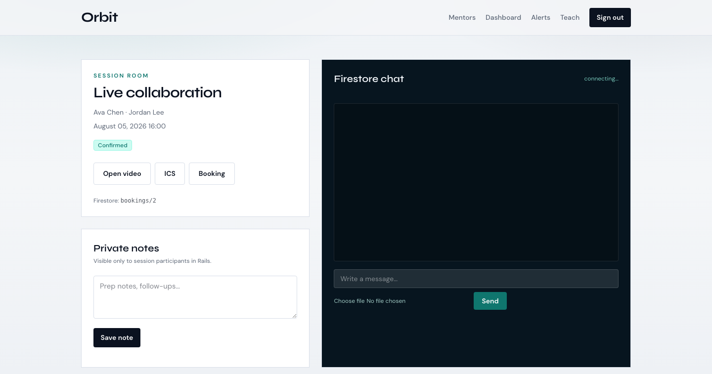
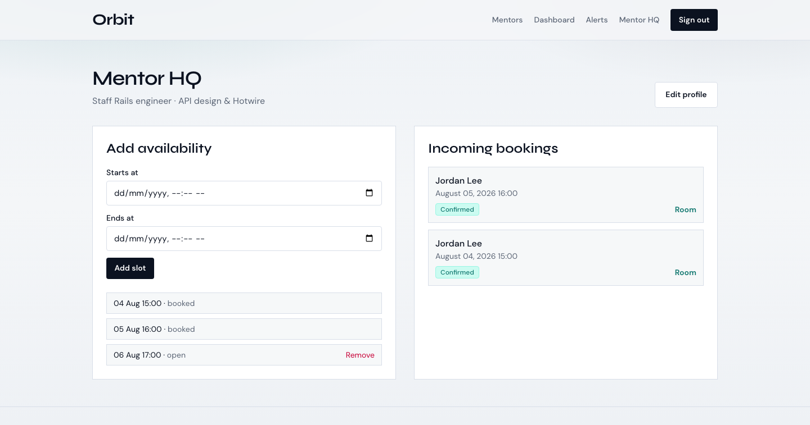

# Orbit

[](https://github.com/oraclekartik/RR/actions/workflows/ci.yml)


**Orbit** is an open-source **live skill-session marketplace** built as a single Rails 8 app.

Rails owns bookings, money, reviews, and authorization. Firebase owns identity and Firestore-powered live rooms (chat, presence, typing, attachments).

> Portfolio-ready reference app: Hotwire, Pundit, Solid Queue, Stripe (optional), and a production-shaped Firestore schema with security rules in-repo.

## Screenshots

| Home | Mentors |
|------|---------|
|  |  |

| Mentor profile | Dashboard |
|----------------|-----------|
|  |  |

| Booking | Live room |
|---------|-----------|
|  |  |



Regenerate screenshots (Chrome required, server on :3000):

```bash
bin/rails orbit:screenshots
```

## Features

- Firebase Auth (Google) → verified Rails session
- Mentor profiles, skills, availability slots
- Booking lifecycle: create, cancel, complete, ICS calendar download
- Optional Stripe Checkout
- Reviews after completed sessions
- Favorites + in-app notifications
- Private Rails session notes
- Firestore live room: chat, presence, typing, file attachments
- Mentor search / skill filters / sort
- Admin dashboard (users, bookings, listing moderation)
- Solid Queue session reminder emails
- Minitest coverage for core flows
- MIT license + contributor docs

## Stack

| Layer | Choice |
|-------|--------|
| App | Rails 8.1 · Hotwire · Tailwind · Importmap |
| Domain DB | SQLite (dev) · Postgres-ready |
| Auth | Firebase Auth + JWKS verification |
| Realtime | Cloud Firestore |
| Files | Firebase Storage |
| Jobs | Solid Queue |
| Payments | Stripe Checkout (optional) |
| AuthZ | Pundit |

## Quick start

```bash
git clone https://github.com/oraclekartik/RR.git
cd RR
cp .env.example .env
# Ruby 3.4+ on PATH (Homebrew: /opt/homebrew/opt/ruby/bin)
bin/setup
bin/rails db:seed
bin/rails server
```

Open **http://localhost:3000** (use `localhost`, not `127.0.0.1`, once Firebase Auth is enabled).

### Demo without Firebase

1. Home → **Dev login** (local/test only)
2. Browse mentors → book a slot → open **Live room**
3. Sign in as `Orbit Admin` for `/admin`

Without Stripe keys, bookings confirm immediately.

### Wire Firebase

1. Create a Firebase project
2. Enable **Authentication → Google**
3. Create **Firestore** + **Storage**
4. Add authorized domain: `localhost` (not `127.0.0.1:3000`)
5. Copy web config into `.env`
6. Deploy rules:

```bash
firebase deploy --only firestore:rules,storage
```

Details: [docs/FIRESTORE.md](docs/FIRESTORE.md)

### Wire Stripe (optional)

Set `STRIPE_SECRET_KEY`, `STRIPE_PUBLISHABLE_KEY`, `STRIPE_WEBHOOK_SECRET`.  
Webhook: `POST /stripe/webhook` (`checkout.session.completed`).

## Firestore shape

```text
rooms/{bookingId}
  messages/{id}   # text | system | file
  presence/{uid}
  typing/{uid}
user_public/{uid}
```

Storage: `rooms/{bookingId}/attachments/...`  
See [docs/FIRESTORE.md](docs/FIRESTORE.md) and [docs/ARCHITECTURE.md](docs/ARCHITECTURE.md).

## Project map

```text
app/models/                 domain
app/services/bookings/      create/cancel/complete/ICS
app/services/firebase/      ID token verifier
app/javascript/firebase/    shared Firebase bootstrap
app/javascript/controllers/ auth + Firestore room
firestore.rules             member-scoped security
storage.rules               attachment limits
docs/                       architecture + screenshots
```

## Tests

```bash
bin/rails test
```

## Contributing

See [CONTRIBUTING.md](CONTRIBUTING.md) and [CODE_OF_CONDUCT.md](CODE_OF_CONDUCT.md).  
Security: [SECURITY.md](SECURITY.md).

## License

[MIT](LICENSE)
